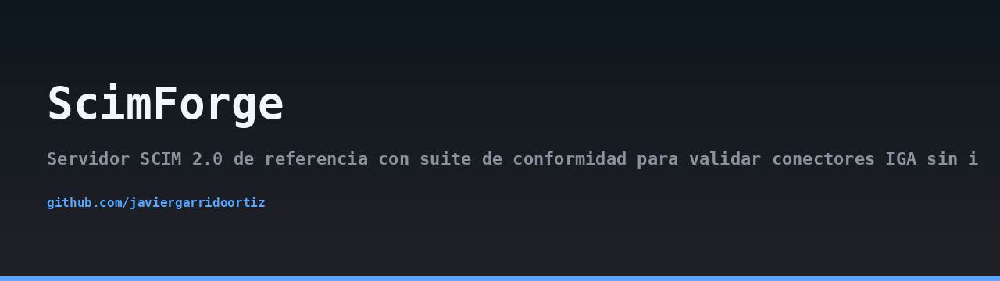
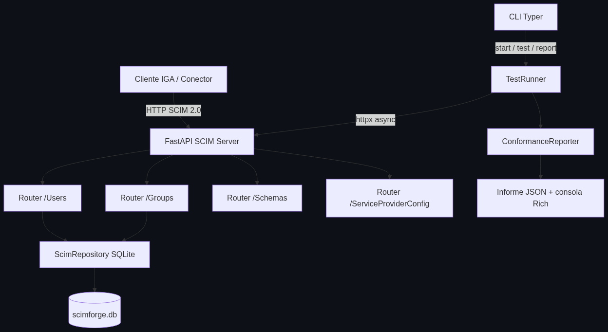
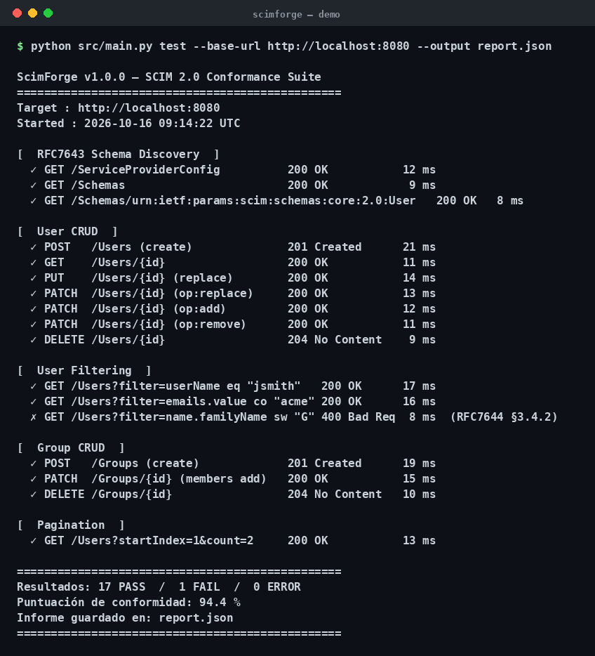

## Architecture



## Demo



> 🇪🇸 Lee esto en [español](README.md)

# ScimForge

[](LICENSE)
[](https://www.python.org/downloads/)
[](https://fastapi.tiangolo.com/)
[](https://datatracker.ietf.org/doc/html/rfc7643)

ScimForge is a reference SCIM 2.0 server with a built-in conformance suite. It is designed so that IGA (Identity Governance and Administration) connector teams can validate their integrations without needing real infrastructure, external directories, or vendor-specific tenants.

## The problem

When you build a connector for an IGA platform (SailPoint, Saviynt, Okta, OneLogin, etc.), you have to talk to a SCIM 2.0 endpoint. In practice this means:

- You depend on a live tenant that someone else controls.
- You cannot reproduce edge cases (PATCH with `remove`, pagination with `startIndex`, filtering with `co` or `sw`).
- You cannot run tests in CI because the tenant is not always available.
- You cannot measure whether your connector is RFC 7643/7644 compliant or just "works against that one vendor".

ScimForge gives you a local, deterministic, RFC-faithful SCIM server plus a conformance suite that tells you exactly which checks pass, which fail, and why.

## Motivation

- **Deterministic**: SQLite in-memory for tests, file-backed for the server.
- **RFC-faithful**: schemas, error payloads, PATCH semantics, and filter grammar follow RFC 7643 and RFC 7644.
- **Portable**: the conformance runner accepts any base URL, not just `localhost`.
- **Zero external deps**: no network calls, no cloud services, no hidden telemetry.
- **Readable**: small, explicit modules that you can fork and extend.

## Architecture

ScimForge is split into three decoupled layers.

### 1. Reference SCIM server

A FastAPI application that exposes the standard SCIM endpoints. Resources are modelled with Pydantic v2 and mirror the SCIM schema exactly, including the enterprise user extension. Persistence is handled by `ScimRepository`, an async CRUD layer on top of SQLite via `aiosqlite`. The SCIM filter engine supports `eq`, `co`, `sw`, `pr`, `gt`, `ge`.

### 2. Conformance suite

The `TestRunner` module launches the test battery against any base URL using `httpx.AsyncClient`. Tests are grouped into:

- Schema Discovery
- User CRUD
- User PATCH (`op: add`, `op: replace`, `op: remove`)
- User Filtering
- Pagination
- Group CRUD
- Group Membership

Each test records the HTTP status code obtained, the response time, and the expected result per the RFC.

### 3. CLI (Typer)

Three commands:

- `serve` — starts the server with Uvicorn.
- `test` — runs the conformance suite against a given URL.
- `report` — renders or converts a saved JSON report.

The `ConformanceReporter` uses Rich to render colored PASS/FAIL tables and computes the overall conformance score.

## Installation

```bash
git clone https://github.com/javiergarrido/scimforge.git
cd scimforge
python -m venv .venv
source .venv/bin/activate
pip install -r requirements.txt
```

Python 3.11 or newer is required.

## Usage

### Start the reference server

```bash
scimforge serve --host 127.0.0.1 --port 8000 --db ./scimforge.db
```

The server exposes `/Users`, `/Groups`, `/Schemas`, and `/ServiceProviderConfig`. All endpoints require the `Authorization: Bearer <token>` header if `SCIMFORGE_TOKEN` is set in the environment.

### Run the conformance suite

Against the local server:

```bash
scimforge test --url http://127.0.0.1:8000 --token $SCIMFORGE_TOKEN
```

Against any other SCIM endpoint:

```bash
scimforge test --url https://scim.example.com --token $TENANT_TOKEN --output report.json
```

### Render a saved report

```bash
scimforge report --input report.json
```

Or export it to Markdown for a PR comment:

```bash
scimforge report --input report.json --format markdown --output conformance.md
```

## SCIM endpoints

| Method | Path | Description |
| --- | --- | --- |
| GET | `/ServiceProviderConfig` | Server capabilities |
| GET | `/Schemas` | List of supported schemas |
| GET | `/Schemas/{id}` | Schema by URN |
| GET | `/Users` | List users with filter, sort, pagination |
| POST | `/Users` | Create user |
| GET | `/Users/{id}` | Retrieve user |
| PUT | `/Users/{id}` | Replace user |
| PATCH | `/Users/{id}` | Partial update |
| DELETE | `/Users/{id}` | Delete user |
| GET | `/Groups` | List groups |
| POST | `/Groups` | Create group |
| GET | `/Groups/{id}` | Retrieve group |
| PUT | `/Groups/{id}` | Replace group |
| PATCH | `/Groups/{id}` | Partial update |
| DELETE | `/Groups/{id}` | Delete group |

## Conformance checks

| Group | Checks | RFC reference |
| --- | --- | --- |
| Schema Discovery | 4 | RFC 7643 §7 |
| User CRUD | 10 | RFC 7644 §3.1–3.6 |
| User PATCH | 6 | RFC 7644 §3.5.2 |
| User Filtering | 8 | RFC 7644 §3.4.2.2 |
| Pagination | 4 | RFC 7644 §3.4.2.4 |
| Group CRUD | 8 | RFC 7644 §3.1–3.6 |
| Group Membership | 5 | RFC 7643 §4.2 |

Each check reports the HTTP status code observed, the response time in milliseconds, and a PASS/FAIL verdict. The final score is the percentage of passing checks.

## Use cases

- Validate a new IGA connector before shipping it to a customer.
- Reproduce a customer-reported SCIM bug in a deterministic environment.
- Run SCIM conformance in CI without touching a real tenant.
- Teach SCIM 2.0 with a small, readable, RFC-faithful implementation.
- Compare vendor behaviour against the RFC: point the suite at the vendor URL and read the report.

## Ethical notice

ScimForge is a reference implementation intended for testing and education. It is not hardened for production: it does not implement rate limiting, multi-tenancy, audit logging, or fine-grained authorization. Do not expose it to the public internet. Do not use it to store real personal data. When running the conformance suite against a third-party endpoint, make sure you have explicit permission from the owner of that endpoint.

## License

MIT. See [LICENSE](LICENSE).
