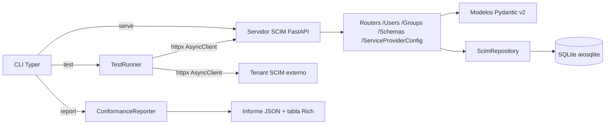

## Arquitectura


## Demo


> 🇬🇧 Read this in [English](README.en.md)

# ScimForge

[](https://www.python.org/)
[](https://fastapi.tiangolo.com/)
[](LICENSE)
[](tests/)

Servidor SCIM 2.0 de referencia con suite de conformidad integrada para validar conectores IGA sin necesidad de infraestructura real.

## El problema

Cuando se desarrolla o integra un conector IGA (Identity Governance and Administration) contra un proveedor SCIM 2.0, el ciclo de feedback suele depender de un tenant real: credenciales, red, cuotas y, en muchos casos, un entorno productivo que no se puede ensuciar con pruebas de PATCH o filtros mal formados. Esto convierte el desarrollo en un proceso lento, caro y difícil de automatizar en CI.

ScimForge resuelve ese problema ofreciendo dos cosas en un mismo paquete:

1. Un **servidor SCIM 2.0 de referencia** que implementa RFC 7643 (esquemas) y RFC 7644 (protocolo) con persistencia local SQLite.
2. Una **suite de conformidad** que puede lanzarse contra cualquier URL base (local o remota) y que produce un informe con puntuación PASS/FAIL por check.

De este modo puedes desarrollar el conector contra un servidor local, validar su comportamiento contra el servidor de referencia y, después, apuntar la misma suite a un tenant real para auditar su grado de conformidad.

## Motivación: contexto SailPoint y SCIM

En despliegues IGA reales (SailPoint IdentityIQ, IdentityNow, conectores propios) el plano de aprovisionamiento se apoya casi siempre en SCIM 2.0. Los conectores suelen fallar por detalles sutiles del RFC:

- Filtros compuestos mal serializados (`userName eq "a" and active eq true`).
- PATCH con `op:add` sobre atributos multivaluados sin `path`.
- Paginación con `startIndex` y `count` fuera de rango.
- Respuestas 200 en lugar de 201 al crear un recurso.
- Falta de `meta.location` o `meta.version` en las respuestas.

ScimForge nace para detectar esos fallos de forma sistemática, sin depender del proveedor y sin tocar datos reales.

## Arquitectura



Tres capas desacopladas:

- **Servidor de referencia**: FastAPI + Pydantic v2 + SQLite asíncrono.
- **Suite de conformidad**: `TestRunner` con httpx AsyncClient, agnóstico del destino.
- **CLI**: Typer con los comandos `serve`, `test` y `report`, y salida enriquecida con Rich.

## Instalación

Requiere Python 3.11 o superior.

```bash
python -m venv .venv
source .venv/bin/activate  # En Windows: .venv\Scripts\activate
pip install -r requirements.txt
```

## Uso

### 1. Arrancar el servidor de referencia

```bash
python -m src.main serve --host 127.0.0.1 --port 8080 --db ./scimforge.db
```

El servidor expone los endpoints SCIM 2.0 en `http://127.0.0.1:8080`. Si se omite `--db`, se usa `sqlite:///:memory:` (útil para pruebas rápidas).

### 2. Ejecutar la suite de conformidad

```bash
python -m src.main test --base-url http://127.0.0.1:8080 --output report.json
```

También puedes apuntar a un tenant externo:

```bash
python -m src.main test --base-url https://tenant.example.com/scim/v2 --token $SCIM_TOKEN --output report.json
```

La suite ejecuta los grupos: Schema Discovery, User CRUD, User PATCH, User Filtering, Pagination, Group CRUD y Group Membership.

### 3. Mostrar o convertir un informe

```bash
python -m src.main report --input report.json
python -m src.main report --input report.json --format json --output summary.json
```

El comando `report` renderiza una tabla Rich con PASS/FAIL por check y calcula la puntuación de conformidad global.

## Endpoints SCIM implementados

| Endpoint | Método | RFC | Descripción |
| --- | --- | --- | --- |
| `/ServiceProviderConfig` | GET | RFC 7643 §5 | Capacidades del servidor |
| `/Schemas` | GET | RFC 7643 §7 | Lista de esquemas soportados |
| `/Schemas/{id}` | GET | RFC 7643 §7 | Esquema concreto |
| `/Users` | GET | RFC 7644 §3.4.2 | Listado con filtros y paginación |
| `/Users` | POST | RFC 7644 §3.3 | Creación de usuario |
| `/Users/{id}` | GET | RFC 7644 §3.4.1 | Recuperación de usuario |
| `/Users/{id}` | PUT | RFC 7644 §3.5.1 | Reemplazo completo |
| `/Users/{id}` | PATCH | RFC 7644 §3.5.2 | Modificación parcial |
| `/Users/{id}` | DELETE | RFC 7644 §3.6 | Borrado |
| `/Groups` | GET | RFC 7644 §3.4.2 | Listado de grupos |
| `/Groups` | POST | RFC 7644 §3.3 | Creación de grupo |
| `/Groups/{id}` | GET | RFC 7644 §3.4.1 | Recuperación de grupo |
| `/Groups/{id}` | PATCH | RFC 7644 §3.5.2 | Modificación de miembros |
| `/Groups/{id}` | DELETE | RFC 7644 §3.6 | Borrado de grupo |

## Checks de conformidad

| Check | RFC | Qué valida |
| --- | --- | --- |
| `schema.discovery` | RFC 7643 §7 | `/Schemas` devuelve lista con `id`, `name` y `attributes` |
| `spc.capabilities` | RFC 7643 §5 | `/ServiceProviderConfig` expone `patch`, `filter`, `bulk` |
| `user.create` | RFC 7644 §3.3 | POST devuelve 201 y cabecera `Location` |
| `user.get` | RFC 7644 §3.4.1 | GET por `id` devuelve 200 con `meta` |
| `user.replace` | RFC 7644 §3.5.1 | PUT reemplaza atributos y respeta `meta.version` |
| `user.patch.add` | RFC 7644 §3.5.2 | `op:add` sobre atributo simple y multivaluado |
| `user.patch.replace` | RFC 7644 §3.5.2 | `op:replace` con `path` y sin `path` |
| `user.patch.remove` | RFC 7644 §3.5.2 | `op:remove` sobre atributo existente |
| `user.filter.eq` | RFC 7644 §3.4.2.2 | Filtro `eq` sobre `userName` |
| `user.filter.co` | RFC 7644 §3.4.2.2 | Filtro `co` sobre `displayName` |
| `user.filter.sw` | RFC 7644 §3.4.2.2 | Filtro `sw` sobre `userName` |
| `user.filter.pr` | RFC 7644 §3.4.2.2 | Filtro `pr` sobre `active` |
| `user.filter.gt` | RFC 7644 §3.4.2.2 | Filtro `gt` sobre `meta.lastModified` |
| `pagination.startIndex` | RFC 7644 §3.4.2.4 | `startIndex` 1-based y `totalResults` coherente |
| `pagination.count` | RFC 7644 §3.4.2.4 | `count` limita `Resources` devueltos |
| `group.create` | RFC 7644 §3.3 | POST `/Groups` con `displayName` y `members` |
| `group.membership.add` | RFC 7644 §3.5.2 | PATCH añade miembro y actualiza `meta.version` |
| `group.membership.remove` | RFC 7644 §3.5.2 | PATCH elimina miembro existente |
| `group.membership.filter` | RFC 7644 §3.4.2.2 | Filtro `eq` sobre `members.value` |
| `error.format` | RFC 7644 §3.12 | Errores devuelven `schemas: ["urn:ietf:params:scim:api:messages:2.0:Error"]` |

## Casos de uso

### CI/CD pipeline

Ejecuta la suite contra el servidor de referencia en cada commit. Si algún check falla, el pipeline rompe antes de tocar un tenant real:

```yaml
- name: Conformance
  run: |
    python -m src.main serve --port 8080 --db sqlite:///:memory: &
    sleep 2
    python -m src.main test --base-url http://127.0.0.1:8080 --output report.json
```

### Desarrollo de conectores

Usa ScimForge como servidor de pruebas mientras implementas el cliente SCIM. Al no depender de red externa, el ciclo de iteración es de milisegundos y puedes inspeccionar el tráfico con cualquier proxy local.

### Auditoría IGA

Apunta la suite a un tenant real con `--token` y obtén un informe con la puntuación de conformidad. Útil para evaluar proveedores antes de firmar o para verificar el cumplimiento tras un upgrade.

## Aviso de uso ético

ScimForge está pensado para pruebas de conformidad sobre sistemas propios o sobre sistemas para los que tengas autorización explícita por escrito. No lo uses contra tenants de terceros sin permiso. La suite emite operaciones de escritura (POST, PUT, PATCH, DELETE): ejecútala contra entornos de staging o contra instancias desechables. El autor no se responsabiliza del uso indebido de esta herramienta.

## Licencia

MIT. Consulta el fichero [LICENSE](LICENSE) para el texto completo.

Autor: Javier Garrido Ortiz.
